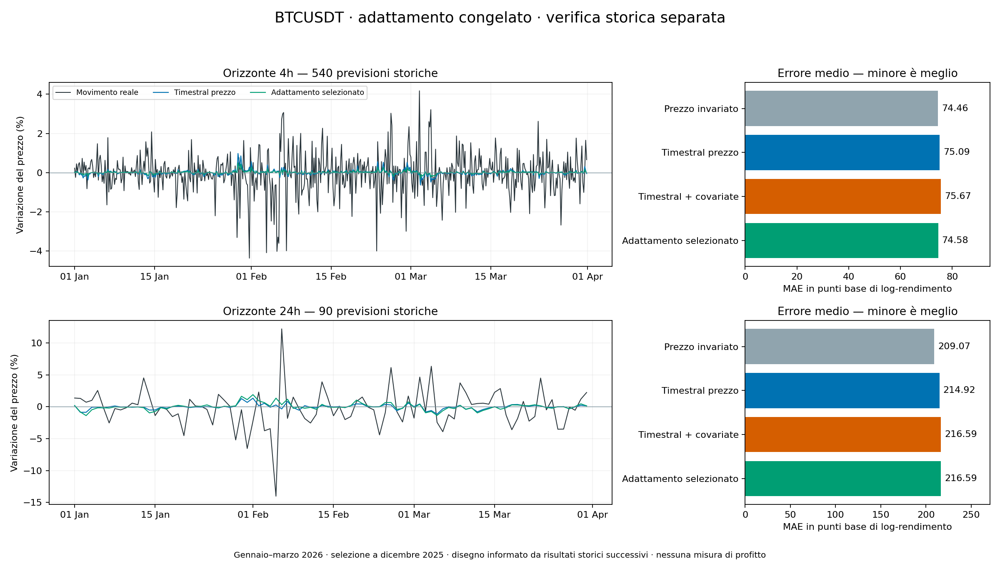

# BTCUSDT: adattamento e verifica su un periodo separato

**Il tentativo non supera il prezzo invariato sul test gennaio–marzo 2026.** Su 540 previsioni a 4h e 90 a un giorno, senza esclusioni, la regola selezionata ha MAE peggiore rispettivamente dello **0,16% e del 3,60%**. Nessuno dei due orizzonti supera il criterio di evidenza fissato prima del test.

[Tutte le 2.520 previsioni in CSV](forecasts.csv) · [Protocollo e comandi](../../docs/timestral-adaptation.md) · [Audit dei dati](independent-verification.json) · [Audit del bootstrap](bootstrap-verification.json)

## Tentativo e separazione dei dati

Timestral-5M e ambiente esistenti sono stati riusati su CPU con due thread, senza fine-tuning. Ogni previsione usa soltanto le 256 ore complete precedenti, ricavate da candele OHLCV Binance Spot BTCUSDT al secondo. Le covariate originali sono volatilità intrahour, intensità degli scambi e imbalance taker; non sono dati di order book o trade tick.

Sono stati confrontati **nove candidati prefissati per orizzonte**: due versioni Timestral originali, tre riduzioni della previsione con correzione del bias e quattro combinazioni ridge, anche con sei feature causali. Il fit iniziale usa ottobre–novembre 2025; dicembre seleziona il candidato con MAE minore. La regola scelta viene poi stimata usando soltanto ottobre–dicembre. Settembre fornisce il contesto iniziale. Gennaio–marzo 2026 è riservato alla verifica finale e non aggiorna parametri, scaler o calibrazione.

| Orizzonte | Selezione a dicembre | MAE dicembre | MAE prezzo invariato |
|---|---|---:|---:|
| 4h | Timestral prezzo × 0,5 + correzione bias | 61,5928 | 61,6614 |
| 24h | Timestral con covariate originale | 137,6896 | 138,8029 |

Il vantaggio di selezione era appena 0,11% e 0,80%. A 4h la formula finale sul log-rendimento è `0.5 × Timestral + 0.000056341658234870806`; il MAE di dicembre riguarda invece la versione stimata su ottobre–novembre. A 24h non ci sono coefficienti aggiuntivi da rifittare: la previsione puntuale resta quella originale con covariate. Cambia soltanto la calibrazione degli intervalli.

## Risultati del test

MAE, RMSE e pinball sono in **punti base di log-rendimento**; minore è meglio. La direzione considera le previsioni non neutrali: il riferimento invariato si astiene, gli altri modelli emettono una direzione per ogni campione. I target non si sovrappongono entro un orizzonte; i due orizzonti condividono dati di mercato.

| Orizzonte | Modello | MAE | RMSE | Pinball | Direzione corretta | Copertura 90% |
|---|---|---:|---:|---:|---:|---:|
| 4h | Prezzo invariato | 74.46 | 105.44 | 20.82 | neutrale | 87.41% |
| 4h | Timestral prezzo | 75.09 | 106.67 | 20.55 | 49.26% | 91.30% |
| 4h | Timestral + covariate | 75.67 | 107.69 | 20.71 | 50.56% | 91.11% |
| 4h | Regola selezionata | 74.58 | 105.88 | 20.96 | 48.33% | 85.56% |
| 24h | Prezzo invariato | 209.07 | 310.58 | 60.32 | neutrale | 84.44% |
| 24h | Timestral prezzo | 214.92 | 318.68 | 59.77 | 50.00% | 85.56% |
| 24h | Timestral + covariate | 216.59 | 324.17 | 61.16 | 53.33% | 84.44% |
| 24h | Regola selezionata | 216.59 | 324.17 | 65.07 | 53.33% | 74.44% |

A **4h**, la correzione riduce il MAE di Timestral prezzo dello 0,68%, ma resta peggiore del prezzo invariato dello 0,16%. Anche l'RMSE è peggiore del riferimento. A **24h**, il MAE della regola selezionata peggiora del 3,60% rispetto al prezzo invariato e dello 0,78% rispetto a Timestral prezzo. La selezione di dicembre non si trasferisce al trimestre separato.

Differenza MAE **regola selezionata meno prezzo invariato**, sempre in punti base; un numero negativo favorisce il modello:

| Orizzonte | Differenza media | Intervallo descrittivo 97,5% | Mesi con MAE migliore | Criterio storico |
|---|---:|---:|---:|---|
| 4h | +0.120 | [-0.413, +0.609] | 2/3 | Non superato |
| 24h | +7.520 | [-7.865, +24.297] | 0/3 | Non superato |

Il bootstrap appaiato usa 13 blocchi di sette giorni, ultimo blocco di sei giorni, 10.000 estrazioni e seed 17. Gli intervalli primari sono corretti con Bonferroni per i due orizzonti. Entrambi includono zero. Il criterio richiede numerosità minima, MAE strettamente migliore, limite superiore sotto zero, almeno due mesi migliori e RMSE non peggiore. A 4h passano soltanto numerosità e mesi; a 24h soltanto numerosità. Pochi blocchi e possibile dipendenza tra settimane limitano l'inferenza: non è dimostrata una superiorità generale in nessuna direzione.

| Orizzonte | Mese | MAE invariato | MAE selezionato |
|---|---|---:|---:|
| 4h | 2026-01 | 53.728 | 54.527 |
| 4h | 2026-02 | 97.908 | 97.566 |
| 4h | 2026-03 | 74.018 | 73.875 |
| 24h | 2026-01 | 150.921 | 170.127 |
| 24h | 2026-02 | 275.717 | 277.555 |
| 24h | 2026-03 | 207.023 | 207.990 |

Gli intervalli adattati coprono l'85,56% dei rendimenti a 4h e il 74,44% a 24h, sotto il 90% nominale. Usano residui di dicembre, che serve anche alla selezione: soltanto 31 per l'orizzonte giornaliero. La previsione giornaliera puntuale coincide con Timestral con covariate, mentre gli intervalli adattati sono diversi dai quantili nativi. Non sono probabilità calibrate di profitto. Nessun quantile valutato è incrociato.

## Cronologia verificabile e limiti

- Selezione e protocollo congelati il **25 ottobre 2026 alle 18:25:33 UTC**, quando la cartella del test era assente. [Bundle e coefficienti](frozen/bundle.json), [protocollo](frozen/protocol.json) e [hash iniziali](freeze-sha256.json) sono conservati senza modifiche.
- Snapshot pubblicato in [`dd24dfc`](https://github.com/giuseppeluvara/klinehouse/commit/dd24dfc1603ab7349b185df1e65d0e02159519ee). GitHub registra la relativa CI alle **18:27:18**, prima della ricevuta di avvio acquisizione alle **18:27:37**: [evidenza GitHub](freeze-publication.json), [ricevuta](test-acquisition-start.json).
- Acquisizione conclusa il 25 ottobre alle 18:38:24. La continuazione era stata interrotta prima dell'inferenza; il test è stato eseguito **una sola volta il 26 ottobre**, senza modificare codice o scelta: [ripresa](continuation.json), [apertura](test-opened.json), [esecuzione](resources/test-run-execution.json). Ogni previsione storica viene salvata prima del relativo esito nel flusso di valutazione.

Il disegno è motivato dai risultati di maggio–luglio 2026 già osservati. Gennaio–marzo è quindi un periodo storico separato per questa selezione, **non una scelta realmente presa a gennaio né un test prospettico**. [Mistral descrive training sintetico e reale](https://mistral.ai/news/timestral/), senza un inventario completo che permetta di escludere sovrapposizioni con questi dati: la contaminazione del pretraining resta non escludibile. Il vecchio holdout agosto 2026–febbraio 2027 non è stato aperto.

Il calcolo usa l'ultimo close disponibile all'anchor; non simula latenza di arrivo dei dati, prezzo eseguibile, commissioni o slippage. Non misura redditività e non effettua ordini. I risultati non sono stati usati per cambiare candidati, parametri, soglie o periodo.

## Risorse e controlli eseguiti

- Sviluppo: **10.540.800 secondi**, 122 giorni; test: **7.776.000 secondi**, 90 giorni. Tutte le 5.088 ore sono complete. Ogni modello è confrontato sugli stessi 630 anchor del test.
- ZIP conservati: 534,4 MB; Parquet: 756,5 MB. I CSV sorgenti, circa 2,71 GB, non sono stati estratti. Allocazione di download e archivi: **1,39 GiB**; cartella di lavoro con artefatti circa **1,40 GiB**. Nessun nuovo modello o ambiente installato. Il controllo finale dello spazio è in [storage-after.txt](resources/storage-after.txt); le variazioni globali dell'SSD includono anche altre attività.
- Preparazione sviluppo/test: 891,21 / 647,28 secondi; picco RSS 252,69 / 225,19 MiB. Esecuzione sviluppo/test: 196,06 / 149,50 secondi di comando completo, incluse verifiche dei dati; picco RSS **4,41 / 3,19 GiB dell'intero processo**, non dei soli pesi. Mac mini M4, 16 GiB di memoria unificata.
- **154 test CI superati**, inclusi otto con TimescaleDB isolato, sul codice finale dell'esperimento: [evidenza CI](ci-code.json). I dati reali non vengono scaricati dalla CI.
- Audit indipendente: SQL diretto e Arrow sui 212 Parquet, ricostruzione di contesti, prezzi, target, feature, selezione dei nove candidati, refit e metriche; massimo scarto nei target e nelle previsioni adattate **zero**. Non riesegue l'inferenza Timestral.
- Secondo audit indipendente: espande i blocchi estratti nelle singole osservazioni e ricalcola tutti i contrasti bootstrap, senza importare il codice di analisi. Scarto nei limiti degli intervalli **zero**. [Script](independent-bootstrap-verifier.py) e [risultato](bootstrap-verification.json) sono inclusi.
- I 39 file protetti sono invariati; nessuna modifica a database di produzione, `.env`, vecchi esperimenti o file locali dell'utente.

I risultati e i checksum completi sono in [analysis.json](analysis.json), [test/results.json](test/results.json) e `sha256.json`. I file di questa cartella sono copie delle evidenze effettive; dati grezzi e pesi restano fuori Git. Per ripetere l'esperimento usare nuove directory e la [sequenza documentata](../../docs/timestral-adaptation.md), preservando questo test ormai osservato.

Il prossimo passo metodologico è una nuova ipotesi preregistrata e dati futuri salvati prima degli esiti, senza riutilizzare gennaio–marzo come holdout. Questo risultato negativo resta il confronto di riferimento; nessuna prova futura viene presentata come già eseguita.
