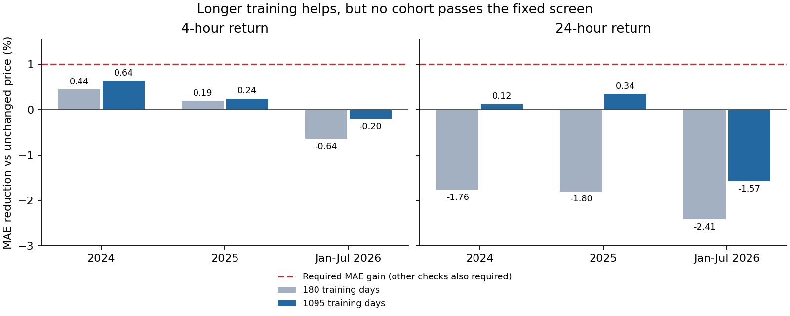

# Capacity, calibration, funding and training history — 26 October 2026

None of the four registered experiment families produces a candidate that passes
its historical screen. Increasing capacity, changing the training objective,
adding settled funding, and extending financial training history were actually
executed, with all unfavorable results retained. This does not prove that useful
prediction is impossible; it does rule out claiming these tested changes as a
working solution on the evaluated samples.

The native-hourly acquisition also exposed a real malformed source candle. Its
handling is repaired and covered by a regression test. The first acquisition
stopped on it; a subsequent network reset was recovered by resuming verified
files. All preprocessing fixes were completed before the history experiment was
registered or fitted.

## Results

Positive percentages mean lower mean absolute log-return error than a zero-return
forecast (unchanged price). These are predictive scores, **not profits**. Every
comparison uses the same samples within its experiment. The first three families
use 1,272 four-hour and 212 daily anchors in January–July 2026. The native-hourly
experiment uses 6,601 anchor/horizon pairs across the three cohorts, each evaluated
with both training windows (13,202 forecasts).

### Capacity / context

| Candidate | 4h MAE gain | 24h MAE gain | Screen |
|---|---:|---:|---|
| `28m_2048` | -0.261% | -1.721% | Fail both |
| `28m_256` | -0.683% | -3.947% | Fail both |
| `5m_2048` | -0.273% | -2.327% | Fail both |
| `5m_256` | -0.446% | -2.747% | Fail both |

### Loss-aligned median

| Candidate | 4h MAE gain | 24h MAE gain | Screen |
|---|---:|---:|---|
| `state_only` | +0.099% | -1.248% | Fail both |
| `state_timestral` | +0.097% | -1.338% | Fail both |

### Nonlinear information ablation

| Candidate | 4h MAE gain | 24h MAE gain | Screen |
|---|---:|---:|---|
| `state` | -0.204% | -1.526% | Fail both |
| `state_timestral` | -0.385% | -2.104% | Fail both |
| `state_timestral_funding` | -0.287% | -3.340% | Fail both |

### Training history

| Cohort | Training days | 4h MAE gain | 24h MAE gain | Screen |
|---|---:|---:|---:|---|
| 2024 | 180 | +0.442% | -1.762% | Fail both |
| 2024 | 1095 | +0.636% | +0.123% | Fail both |
| 2025 | 180 | +0.192% | -1.796% | Fail both |
| 2025 | 1095 | +0.242% | +0.344% | Fail both |
| Jan-Jul 2026 | 180 | -0.643% | -2.414% | Fail both |
| Jan-Jul 2026 | 1095 | -0.205% | -1.572% | Fail both |



Three-year training reduces error relative to six-month training in all six
cohort/horizon comparisons, but gains versus unchanged price remain small in
2024–2025 and become losses in 2026. No favorable year is promoted as the result.

## What was tested, and what was corrected

1. **Model size and context.** Crossed 5M/28M parameters with 256/2,048 past hours,
   keeping the API, target, samples and transformations fixed: 5,936 real forecasts.
   The 5M/256 condition exactly reproduces the original saved point forecasts.
   Constant, linear and sinusoidal control predictions are retained in
   `run/controls.json`. A larger model and context do not establish an edge.
2. **Loss alignment.** The previous ridge calibration optimized squared error;
   the primary screen scores absolute error. An exact weighted conditional-median
   linear program now tests that mismatch, with fixed L1 penalty 0.025,
   180-day monthly fits, 60-day decay and causal scaling. The best four-hour
   improvement is only 0.099%, with uncertainty spanning zero and worse RMSE.
   This is a tested alternative objective, not proof that the earlier loss caused
   the prediction failure.
3. **Nonlinearity and extra information.** A fixed shallow histogram quantile
   regressor compares state, state plus Timestral, and both plus settled funding.
   All 42 monthly fitted models are retained locally. The funding condition uses
   1,002 historical settlements, conservatively delayed one hour after settlement.
   Neither the nonlinear learner nor funding passes the screen.
4. **Training sample size.** The same fixed learner compares 180 versus 1,095
   training days, with identical features and 365-day time decay, across 31 monthly
   cutoffs and two horizons (124 fitted models). This isolates training-window
   length within this experiment. Its hourly volatility/state features differ from
   the second-derived features above, so cross-family score differences cannot be
   attributed to training length alone.
5. **Malformed native candle and interruption recovery.** The checksum-valid
   December 2020 Binance file contains a zero-volume candle at
   `2020-12-21T14:00:00Z` with a close timestamp before its open timestamp.
   `scripts/prepare_timestral_history.py` records the original row and excludes it
   as a gap. It never fills missing prices. Only affected contexts and targets are
   excluded; later valid windows recover. Resume verifies retained ZIPs and their
   checksums, retries transient HTTP failures, and refuses to overwrite a
   normalized dataset. Timestamp units switch from milliseconds to microseconds
   in the source; the tests cover that transition.

## Frozen design and limitations

All four protocols and their SHA-256 receipts were saved before their respective
inference runs. `history-plan.json` was saved before the hourly acquisition. Code,
source, model and output hashes are bound in the protocols and results.

The first three screens require at least 1% MAE improvement, no worse RMSE,
at least five of seven monthly wins, and a paired weekly bootstrap upper bound
below zero (4,000 draws, seed 20261026, two-sided 99.375% interval). History uses
99.583333% intervals for its 12 primary comparisons and at least two-thirds of
monthly wins in **each** cohort. A candidate must pass all three cohorts for a
horizon even to be nominated. These thresholds were not relaxed after results.

- January–July 2026 was already observed. The 2024–2025 design was informed by
  later results, and those years may have appeared in unrelated prior research.
  These are historical research screens, not pristine or prospective holdouts.
- Within-experiment multiplicity adjustments do not correct the whole adaptive
  research history. Continuing to tune until a positive result appears would not
  establish predictive reliability.
- Timestral pretraining contamination cannot be excluded. Checkpoint identity and
  numerical reproduction do not resolve it.
- Funding settlement time plus one hour is an availability assumption; publication
  latency was not independently audited. The target remains BTCUSDT spot; no
  derivative execution or funding PnL is simulated.
- Native 1h data is a separate research source, never mixed into the original 1s
  archive. This experiment cannot prove the value of second-level detail.
- Models are historically refitted using mature labels. Real-time scheduling,
  market execution latency, costs and prospective forecast capture were not tested.
- No source or outcome at or after 2026-08-01 was opened. Existing frozen bundles,
  user files, credentials and protected holdouts were preserved. No orders,
  retention deletion or new background process was activated.

The remaining scientific question is whether a new, explicitly motivated signal
can beat the baseline on a future evaluation fixed in advance. These negative
results do not identify a single hidden software fault that guarantees a remedy.

## Verification and resource use

The independent `verify.py` imports none of the experiment implementations and
performs no training or neural/tree inference. It reconstructs exact sample sets,
source endpoints, causal features, mature training membership, point metrics,
weekly bootstrap intervals and saved median forecasts. It checks all 30 primary
comparisons. The optional local audit reconstructs normalized data directly from
all 83 checksum-verified ZIPs and hashes all 166 saved tree models and both
Timestral checkpoints, without unpickling anything.

The 72 hourly archives total 3,115,468 bytes. They yield 52,564 valid hours and ten
gaps. One malformed row is retained in provenance; other gaps are absent source
hours. The history builder excludes 453 contexts and 15 targets across the full
source. On the previously used overlap, **all 8,016 hourly close prices match the
1s-derived source exactly** in the executed comparison.

The new model download was about 111.3 MB; the funding ZIPs total 10,517 bytes.
The existing Python environment was reused. Local outputs occupy about 33 MiB
and the compressed public bundle about 5.5 MiB, in addition to the new checkpoint.
Raw ZIPs, normalized originals and fitted models remain under the ignored
`research/out/timestral-capacity-20261026` folder. Compressed JSONL files in this
report decompress to the exact bytes covered by each frozen output hash.

| Experiment | Runtime | Peak process RSS |
|---|---:|---:|
| Timestral capacity/context | 122.35 s | 458.3 MiB |
| Conditional median | 2.77 s | 396.7 MiB |
| Nonlinear/funding | 15.07 s | 231.9 MiB |
| Training history | 44.53 s | 273.6 MiB |

The final storage check reports 49.84 GiB available internally, versus 47.82 GiB
at the first check. The change in free space includes other system activity and
is not a measurement of this experiment's growth. No cleanup was performed.
The external AI volume was unavailable; the protected shared model cache remained
2.99 GiB. The general user cache could not be completely measured because of
access restrictions.

Local checks: **191 passed, 8 PostgreSQL-dependent tests skipped**, plus Ruff and
the independent evidence audit. The CI workflow runs the same suite against a
real TimescaleDB service and audits this saved bundle; consult the commit's check
results for its execution status. The local run does not verify migration of the
user's live database.

## Reproduce

Use the repository's existing Timestral environment and installation instructions
in [the pilot documentation](../../docs/timestral.md). The two additional numerical
packages are pinned in `requirements-timestral-calibration.txt`. The model
checkpoints are pinned by revision and SHA-256 in `run/protocol.json`; the 28M
snapshot must be present alongside the existing 5M cache before capacity replay.
Do not substitute a moving model revision.

Verify the public evidence without downloads, training, or inference:

```sh
python reports/timestral-capacity-20261026/verify.py
```

On the original machine, also verify retained raw archives, models and checkpoints:

```sh
python reports/timestral-capacity-20261026/verify.py \
  --local-artifacts research/out/timestral-capacity-20261026
```

Run new experiment copies into **new** output folders, leaving frozen runs intact:

```sh
export OMP_NUM_THREADS=2 OPENBLAS_NUM_THREADS=2
python scripts/run_timestral_capacity.py register --output research/out/capacity-replay
python scripts/run_timestral_capacity.py run --output research/out/capacity-replay
python scripts/run_timestral_median.py register --output research/out/median-replay
python scripts/run_timestral_median.py run --output research/out/median-replay
python scripts/prepare_timestral_funding.py --output research/out/funding-source-replay
python scripts/run_timestral_funding.py register --output research/out/funding-replay \
  --funding-root research/out/funding-source-replay
python scripts/run_timestral_funding.py run --output research/out/funding-replay
python scripts/prepare_timestral_history.py --output research/out/history-source-replay
python scripts/run_timestral_history.py register --output research/out/history-replay \
  --source research/out/history-source-replay \
  --plan reports/timestral-capacity-20261026/history-plan.json
python scripts/run_timestral_history.py run --output research/out/history-replay
```

Use `--resume` for an interrupted hourly acquisition only. Completed normalized
sources and inference outputs are never overwritten. Different platform/library
versions may change floating-point fits; metric and hash verification of this
saved bundle requires no model replay. `plot.py` regenerates the figure.

Official references: [Timestral code](https://github.com/mistralai/timestral),
[28M model card and license](https://huggingface.co/mistralai/Timestral-28M), and
[Binance public archive and timestamp format](https://github.com/binance/binance-public-data).
