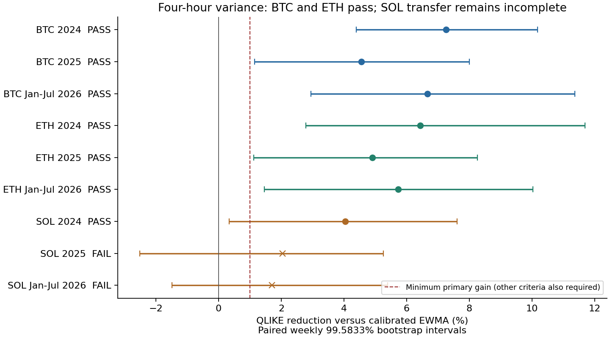

# Prevedere la variabilità separatamente dalla direzione — 27 ottobre 2026

**Il nuovo componente prevede la varianza realizzata nelle quattro ore successive
con risultati storici migliori di due baseline dinamiche su BTC ed ETH. La
previsione della direzione del prezzo resta irrisolta.** Il trasferimento completo
richiedeva il superamento su entrambi gli asset aggiuntivi, ETH e SOL: questo
criterio complessivo **non è superato**, perché SOL fallisce alcuni controlli.
Non viene dichiarata una strategia redditizia, una soluzione universale o una
validazione prospettica.

[Previsioni e risultati BTC](distribution/results.json) ·
[Trasferimento ETH/SOL](transfer/results.json) ·
[Verifica indipendente](verification.json) ·
[Esempio di una previsione storica](forecast-example.json)

## Il risultato utile e i suoi confini

Il target è la somma dei quadrati dei prossimi quattro rendimenti orari di
chiusura, con l'incremento iniziale calcolato dall'ultima chiusura già conosciuta.
È una misura oraria della variabilità, non il quadrato del rendimento finale,
non la volatilità osservata a ogni secondo e non un intervallo sul prezzo.
La varianza può essere prevedibile anche quando i segni dei rendimenti si compensano.

I guadagni sotto riguardano **QLIKE**, un punteggio della varianza condizionale:
positivo significa errore minore, non maggiore accuratezza direzionale né profitto.
Tutte le baseline ricevono la stessa calibrazione stimata soltanto sul passato.

| Asset | Periodo | Guadagno QLIKE vs EWMA | vs persistenza | Esito completo |
|---|---|---:|---:|---|
| BTCUSDT | 2024 | 7.26% | 10.41% | Superato |
| BTCUSDT | 2025 | 4.56% | 11.32% | Superato |
| BTCUSDT | Gen–lug 2026 | 6.67% | 13.61% | Superato |
| ETHUSDT | 2024 | 6.43% | 7.10% | Superato |
| ETHUSDT | 2025 | 4.91% | 11.00% | Superato |
| ETHUSDT | Gen–lug 2026 | 5.73% | 12.86% | Superato |
| SOLUSDT | 2024 | 4.03% | 6.69% | Superato |
| SOLUSDT | 2025 | 2.04% | 10.09% | Non superato |
| SOLUSDT | Gen–lug 2026 | 1.70% | 12.36% | Non superato |



Su BTC il modello supera entrambi i riferimenti in tutti i tre periodi. Su ETH,
acquisito solo dopo aver fissato il metodo di trasferimento, il risultato si
ripete. Su SOL 2025 manca la separazione statistica da EWMA; nel 2026 manca anche
il miglioramento del criterio sul logaritmo della varianza. Non scelgo soltanto
le righe favorevoli: il trasferimento complessivo rimane negativo.

Il modello giornaliero BTC supera i criteri nel 2024 e nel 2026, ma non nel 2025:
l'intervallo della differenza rispetto a EWMA include zero. Anche questo
orizzonte rimane non promosso.

Gli intervalli nominali al 90% coprono circa il 92,8–94,8% degli esiti nei
confronti a quattro ore sui tre asset: sono conservativi. Il modello Gamma è
un'approssimazione; le probabilità non hanno una garanzia di calibrazione futura.

## Cosa emerge sulle cause dei fallimenti precedenti

Ho verificato separatamente due ipotesi, senza presumere che un risultato negativo
fosse necessariamente un bug del modello.

**La persistenza appartiene soprattutto alla variabilità.** Su periodi consecutivi
non sovrapposti di quattro ore, la correlazione dei rendimenti firmati è −0,013,
quella dei rendimenti assoluti è +0,175 e quella del logaritmo della varianza
realizzata è +0,434. A 24 ore sono rispettivamente −0,057, +0,144 e +0,417.
Sono diagnostiche descrittive sui dati già osservati: non provano l'assenza di
ogni segnale direzionale o una causa unica del fallimento di Timestral.

**Prevedere direttamente il segno non risolve la direzione.** Ho eseguito una
regressione logistica con le 11 caratteristiche causali già disponibili,
addestramento mensile su tre anni e parametri fissati. Deve battere sia 50/50
sia la frequenza storica dei rialzi; nessun orizzonte supera il criterio completo.

| Periodo | 4h: guadagno Brier vs 50/50 | 24h: guadagno Brier vs 50/50 |
|---|---:|---:|
| 2024 | +0.460% | -0.279% |
| 2025 | +0.052% | -1.665% |
| 2026 | +0.374% | -2.036% |

L'esito riduce la plausibilità che il problema fosse soltanto la previsione del
livello del prezzo o la metrica MAE. I miglioramenti direzionali a quattro ore
rimangono piccoli e incerti. Non dimostra che BTC sia intrinsecamente imprevedibile.

## Un errore metodologico nel nuovo test, conservato e corretto esplicitamente

Il primo esperimento di questa continuazione, conservato integralmente in
`decomposition/`, chiedeva al modello della varianza media di migliorare QLIKE e
anche l'errore quadratico del **logaritmo di quella stessa previsione**.
Le due perdite hanno ottimi diversi: la media condizionale della varianza e la
media condizionale del suo logaritmo. In generale
`log(E[V|passato]) != E[log(V)|passato]`.

Un controllo con dati Gamma di distribuzione nota lo dimostra: la previsione
corretta della media vince su QLIKE, mentre un'altra quantità vince sulla perdita
logaritmica. Non è un errore di calcolo del vecchio punteggio; era una specifica
che chiedeva a una sola uscita due compiti differenti. Il primo criterio congelato
resta fallito, senza riscriverne risultati o soglie.

Ho quindi registrato **un secondo esperimento**, prima di eseguirlo. Questo
prevede una distribuzione e produce uscite distinte: media della varianza, media
del logaritmo, quantili e probabilità di superare la variabilità recente.
Riusa esattamente i coefficienti già stimati del modello medio. La calibrazione
moltiplicativa della media e la forma Gamma sono stimate sui soli campioni di
addestramento e applicate **anche alle due baseline**. Il vantaggio della seconda
valutazione non viene retroattivamente attribuito al primo test.

## Metodo fissato e trasferimento

Il modello usa le medie dei rendimenti orari al quadrato sulle ultime 24, 168 e
720 ore, dopo trasformazione logaritmica e standardizzazione del solo training.
Una regressione Gamma con collegamento logaritmico produce una media positiva.
È un modello ispirato alla separazione delle scale temporali di
[HAR-RV di Corsi](https://doi.org/10.1093/jjfinec/nbp001), non una replica esatta
né una dimostrazione basata sui risultati di quell'articolo.

Parametri: `GammaRegressor(alpha=0.01, max_iter=1000, tol=1e-8)`; caratteristiche
standardizzate limitate a ±8; finestra di training di 1.095 giorni; refit all'inizio
del mese; etichette già mature; nessuna pesatura per classe o decadimento temporale.
La [documentazione ufficiale](https://scikit-learn.org/stable/modules/generated/sklearn.linear_model.GammaRegressor.html)
descrive il modello con collegamento logaritmico. Il classificatore usa
`LogisticRegression(C=0.1, solver="lbfgs", max_iter=1000, tol=1e-8)`.

Baseline: varianza delle ultime 24 ore scalata all'orizzonte e media esponenziale
con emivita di 24 ore sulle ultime 720. Per ogni metodo, il rapporto medio tra
varianza osservata e previsione sul training corregge il livello; la forma Gamma
è stimata sui residui normalizzati. La media del logaritmo e i quantili derivano
dalla distribuzione calibrata. Non vengono usati residui del mese da prevedere.

Il trasferimento ETH/SOL fissa lo stesso algoritmo prima di acquisire i loro dati.
Ogni asset è rifittato soltanto sul proprio passato; non sono gli stessi pesi BTC
applicati immutati. Sono nuovi dati per questa selezione del metodo, ma non posso
certificare che non siano mai stati osservati in altre ricerche.
Gli asset condividono inoltre condizioni di mercato: il trasferimento non equivale
a repliche statisticamente indipendenti né sostituisce una verifica prospettica.

Per superare il criterio, ogni periodo richiede almeno 1% di riduzione QLIKE
rispetto a **entrambe** le baseline calibrate, nessun peggioramento della MSE della
media prevista del logaritmo, vittoria in almeno due terzi dei mesi e limite
superiore del bootstrap appaiato settimanale inferiore a zero. Uso 4.000 estrazioni,
seme 20261027 e intervalli bilaterali 99,583333% per i 12 confronti primari di
ciascuna fase. Tutti i periodi devono passare; il trasferimento richiede anche
entrambi gli asset. Queste correzioni non controllano l'intera ricerca adattiva
precedente. Una settimana potrebbe non esaurire la dipendenza temporale.

BTC 2024–luglio 2026 era già osservato: il risultato è storico ed esplorativo.
Il trasferimento è storico, non una raccolta di previsioni salvate prima degli
esiti reali. Nessun dato da agosto 2026 in avanti è stato aperto, nessun holdout
precedente è stato riutilizzato e nessun servizio operativo è stato attivato.

## Cosa è implementato ed effettivamente verificato

- Due moduli riutilizzabili, protocolli, runner e un comando di previsione singola.
- 6.601 campioni BTC nella prima fase; 6.601 previsioni distribuzionali BTC e
  11.316 sui due asset aggiuntivi. Gli output includono tutti gli esiti negativi.
- Il verificatore separato ricostruisce caratteristiche e target dalle chiusure,
  controlla appartenenza esatta dei campioni, disponibilità temporale delle
  etichette, normalizzazioni, previsioni dai coefficienti, calibrazione, metriche
  e 48 confronti bootstrap. Non importa i moduli sperimentali e non rifitta modelli.
- Il controllo delle condizioni di ottimo dà uno scarto massimo del gradiente
  di circa `8.31e-8`, sotto la soglia di verifica `1e-5`.
- L'audit opzionale ricostruisce i dati direttamente da 144 ZIP checksum-verificati.
  Tre righe malformate sono escluse e conservate nella provenienza; nessuna
  interpolazione dei prezzi. Gli intervalli che attraversano gap sono scartati.
- 14 nuovi test controllano segnali artificiali noti, avvelenamento dei dati
  futuri, sovrapposizioni, target esatti, differenza fra le due medie, calibrazione
  simmetrica delle baseline e rifiuto di modelli mensili obsoleti.
- Suite locale: **205 passati, 8 integrazioni PostgreSQL riservate alla CI**.
  Il workflow esegue la suite con TimescaleDB reale e verifica entrambi i bundle
  di ricerca. Il suo esito va letto nei check del commit pubblicato.

Un assegnamento locale inutilizzato nel runner di trasferimento è stato rimosso
dopo l'esecuzione per soddisfare Ruff. Lo script effettivamente eseguito è
conservato in `transfer/original-run_variance_transfer.py`, con ricevuta della
modifica in `transfer/lint-fix.json`. Il verificatore controlla che l'unica
differenza sia quella riga; nessun modello o risultato è stato ricalcolato.

| Esecuzione | Tempo | RSS di picco |
|---|---:|---:|
| Separazione direzione/varianza BTC | 22.68 s | 267.6 MiB |
| Distribuzione BTC | 17.77 s | 258.5 MiB |
| Trasferimento ETH e SOL | 35.29 s | 324.6 MiB |

Scaricati 5,548,706 byte di ZIP ETH/SOL, senza nuovi
checkpoint o ambienti. Circa 47 MiB complessivi fra output locali e bundle pubblico
compresso; i dati grezzi restano nel percorso ignorato della ricerca. Spazio interno
misurato prima/dopo: 48,42 / 48,37 GiB. Nessuna pulizia. La cache condivisa dei modelli
resta 2,99 GiB; il volume esterno non era disponibile. La misura della cache generale
dell'utente rimane incompleta per restrizioni di accesso.

## Riprodurre una previsione e la verifica

I file JSONL compressi si espandono negli stessi byte degli hash congelati.
La verifica pubblica non richiede download né inferenza:

```sh
OMP_NUM_THREADS=2 OPENBLAS_NUM_THREADS=2 \
  .venv-timestral/bin/python scripts/verify_variance_research.py
```

Sulla macchina originale, includere l'audit dei ZIP mantenuti localmente:

```sh
.venv-timestral/bin/python scripts/verify_variance_research.py \
  --raw-transfer research/out/timestral-transfer-20261027
```

Esempio storico al 31 luglio 2026, ore 20 UTC, senza utilizzare le candele
successive come input e senza sostituire un modello mensile mancante con uno vecchio:

```sh
.venv-timestral/bin/python scripts/preview_variance_forecast.py \
  --hours reports/timestral-capacity-20261026/history-source/hours.jsonl.gz \
  --parameters reports/timestral-decomposition-20261027/decomposition/parameters.json \
  --calibrations reports/timestral-decomposition-20261027/distribution/calibrations.json \
  --symbol BTCUSDT --anchor 2026-07-31T20:00:00Z \
  --output research/out/risk-preview-new.json
```

L'esempio salvato restituisce una radice della varianza media prevista di 0,793%
e un intervallo di volatilità realizzata al 90% di circa 0,113–1,451%. **Non è un
intervallo sul rendimento o sul prezzo** e la radice della varianza media non è
la media della volatilità. La probabilità di superare la variabilità recente è
circa 44,4%, senza una previsione rialzo/ribasso.

Per rifittare la prima fase in una directory nuova:

```sh
mkdir research/out/decomposition-replay
cp reports/timestral-decomposition-20261027/decomposition/plan.json research/out/decomposition-replay/plan.json
OMP_NUM_THREADS=2 OPENBLAS_NUM_THREADS=2 .venv-timestral/bin/python scripts/run_timestral_decomposition.py register --root research/out/decomposition-replay
OMP_NUM_THREADS=2 OPENBLAS_NUM_THREADS=2 .venv-timestral/bin/python scripts/run_timestral_decomposition.py run --root research/out/decomposition-replay
```

La fase distribuzionale riusa intenzionalmente i coefficienti originali. Sulla
macchina originale sono già presenti. Su un checkout nuovo, ripristinare **solo**
questi due piccoli prerequisiti dai file pubblicati, senza sovrascritture:

```python
from pathlib import Path
pairs = {
    "research/out/timestral-decomposition-20261027/parameters.json":
        "reports/timestral-decomposition-20261027/decomposition/parameters.json",
    "research/out/timestral-distribution-20261027/protocol.json":
        "reports/timestral-decomposition-20261027/distribution/protocol.json",
}
for target, source in pairs.items():
    path, content = Path(target), Path(source).read_bytes()
    if path.exists():
        if path.read_bytes() != content:
            raise ValueError("Existing artifact differs; do not overwrite")
    else:
        path.parent.mkdir(parents=True, exist_ok=True)
        with path.open("xb") as stream:
            stream.write(content)
```

Poi, con destinazioni che non esistono ancora:

```sh
mkdir research/out/distribution-replay
cp reports/timestral-decomposition-20261027/distribution/plan.json research/out/distribution-replay/plan.json
OMP_NUM_THREADS=2 OPENBLAS_NUM_THREADS=2 .venv-timestral/bin/python scripts/run_timestral_distribution.py register --root research/out/distribution-replay
OMP_NUM_THREADS=2 OPENBLAS_NUM_THREADS=2 .venv-timestral/bin/python scripts/run_timestral_distribution.py run --root research/out/distribution-replay
.venv-timestral/bin/python scripts/run_variance_transfer.py register --root research/out/transfer-replay
.venv-timestral/bin/python scripts/run_variance_transfer.py prepare --root research/out/transfer-replay
OMP_NUM_THREADS=2 OPENBLAS_NUM_THREADS=2 .venv-timestral/bin/python scripts/run_variance_transfer.py run --root research/out/transfer-replay
```

La preparazione di trasferimento può riprendere ZIP già scaricati verificandoli;
non sovrascrive un'acquisizione completata. I protocolli includono hash del codice,
input e versioni. L'ambiente della ricerca usa i requisiti già presenti nel
repository; per la verifica numerica servono NumPy e SciPy. `plot.py` rigenera
la figura. Una ripetizione su librerie o piattaforme diverse può produrre piccole
differenze numeriche; la verifica dei file salvati non dipende da un nuovo fit.

Resta necessaria una validazione prospettica separata, senza violare il periodo
protetto, prima di considerare l'uso operativo. La capacità di prevedere rischio
non viene presentata come soluzione alla previsione della direzione.
