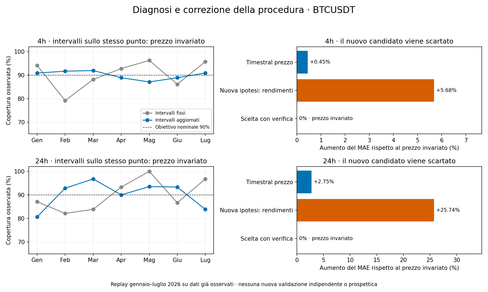

# Diagnosi e correzione della procedura Timestral

**Corretti la selezione obbligata di un modello e gli intervalli fissi. Non è stato trovato un vantaggio predittivo sul rendimento.** La nuova ipotesi di previsione diretta dei rendimenti è peggiore ed è scartata. La procedura torna esplicitamente al prezzo invariato quando manca evidenza per scegliere un modello; questo non viene conteggiato come successo di Timestral.

[Codice e comandi](../../docs/timestral-repair.md) · [Analisi completa](run/analysis-recovered.json) · [7.420 righe di previsioni CSV](run/forecasts.csv) · [Verifica](replay-verification.json)

## Cosa non funzionava

1. La selezione precedente sceglieva il migliore tra nove modelli anche se non batteva il prezzo invariato. L'esperimento lo dichiarava, ma mancava una regola utilizzabile per rifiutare un modello senza evidenza. Inoltre il giornaliero veniva scelto su appena 31 osservazioni di dicembre.
2. Gli intervalli ricavati da dicembre rimanevano fissi durante cambiamenti di volatilità. L'adattamento giornaliero aveva ridotto la copertura al 74,44%; la correzione del punto non risolveva questo problema.
3. Non c'è evidenza che la chiamata all'API o l'allineamento del target fossero sbagliati. Le **1.274 previsioni Timestral prezzo comuni** ai vecchi confronti sono state riprodotte con scarto zero. Nel replay gennaio–luglio, la correlazione tra previsione originale e rendimento è 0,008 a 4h e -0,080 a 24h: la configurazione non mostra un segnale utile stabile. Aumentare semplicemente la scala della previsione non risolve questo limite.

La mancanza di fine-tuning non è di per sé un bug. La correzione appropriata è verificare il segnale, consentire l'astensione e provare un'ipotesi esplicita senza promuovere risultati sfavorevoli.

## Cambiamenti implementati ed eseguiti

- **Selezione mensile causale:** usa i tre mesi completi precedenti, con almeno 60 osservazioni giornaliere o 360 a 4h. Richiede MAE migliore, RMSE non peggiore, almeno due mesi favorevoli e limite superiore del bootstrap sotto zero. Il prezzo invariato è sempre ammesso. La scelta rimane fissa nel mese; nessun esito futuro entra nella decisione.
- **Intervalli aggiornati:** residui maturati negli ultimi 90 giorni, divisi per la volatilità nota al momento di ciascuna previsione e riportati alla volatilità corrente. La statistica d'ordine usa il rango finito `ceil((n+1)*0.90)`. La previsione puntuale non cambia per effetto della calibrazione.
- **Nuova ipotesi reale:** Timestral riceve rendimenti cumulati sull'orizzonte invece dei livelli del log-prezzo, usando esattamente gli stessi 256 close passati. Prevede h passi e usa l'ultimo valore; non somma quantili marginali. Modello, pesi e CPU restano gli stessi. [API ufficiale](https://github.com/mistralai/timestral/tree/a534bdbd244d64f3d9d743f46c7bf6fc330ed4ff).

## Risultati del replay gennaio–luglio 2026

Sono valutati 1.272 anchor a 4h e 212 giornalieri. MAE in punti base di log-rendimento; una variazione positiva indica un errore peggiore del prezzo invariato.

| Orizzonte | Modello | MAE | Aumento errore |
|---|---|---:|---:|
| 4h | Prezzo invariato, intervalli fissi | 64.384 | 0.00% |
| 4h | Timestral prezzo | 64.671 | +0.45% |
| 4h | Nuova ipotesi sui rendimenti | 68.038 | +5.68% |
| 4h | Scelta subordinata all’evidenza | 64.384 | 0.00% |
| 24h | Prezzo invariato, intervalli fissi | 171.131 | 0.00% |
| 24h | Timestral prezzo | 175.832 | +2.75% |
| 24h | Nuova ipotesi sui rendimenti | 215.180 | +25.74% |
| 24h | Scelta subordinata all’evidenza | 171.131 | 0.00% |

Nessun candidato supera il criterio nei 14 controlli mensili (sette per orizzonte). La procedura sceglie il prezzo invariato per tutti i 1.484 anchor. La nuova rappresentazione dei rendimenti peggiora il MAE del 5,68% a 4h e del 25,74% a un giorno: non è una soluzione alla previsione direzionale e non viene promossa.

Confronto degli intervalli intorno allo **stesso punto zero**, sull'intero replay. Larghezza e pinball sono in punti base; per il pinball minore è meglio. La copertura nominale è 90%.

| Orizzonte | Metodo | Copertura | Larghezza media | Pinball |
|---|---|---:|---:|---:|
| 4h | Prezzo invariato, intervalli fissi | 90.49% | 319.17 | 18.172 |
| 4h | Prezzo invariato, intervalli aggiornati | 90.02% | 296.80 | 17.775 |
| 24h | Prezzo invariato, intervalli fissi | 90.09% | 685.62 | 47.522 |
| 24h | Prezzo invariato, intervalli aggiornati | 90.09% | 837.42 | 46.816 |

Sul trimestre gennaio–marzo, che aveva evidenziato il problema:

| Orizzonte | Copertura fissa | Copertura aggiornata | Riduzione pinball |
|---|---:|---:|---:|
| 4h | 87.41% | 91.48% | 2.48% |
| 24h | 84.44% | 90.00% | 3.68% |

La maggiore copertura del trimestre comporta intervalli più larghi. Sul totale gennaio–luglio, la larghezza media a 4h diminuisce, mentre quella giornaliera aumenta; il pinball migliora in entrambi i casi. Non è una garanzia di calibrazione: la copertura giornaliera aggiornata scende all'80,65% in gennaio e all'83,87% in luglio. Vanno letti insieme copertura, larghezza e punteggio dei quantili.

## Verifica, risorse e limiti

Il replay usa storia già osservata: ottobre–dicembre 2025 inizializza la procedura, gennaio–luglio 2026 la verifica retrospettivamente. La correttezza causale del calcolo **non trasforma questi mesi in un nuovo holdout**. La verifica prospettica rimane da eseguire. Nessun dato del periodo protetto agosto 2026–febbraio 2027 è stato aperto.

Il bootstrap della selezione usa 2.000 estrazioni settimanali, seed 17 e intervalli 98,75%, correggendo quattro confronti candidato/orizzonte per decisione. Non corregge l'intera sequenza di decisioni nel tempo e non prova indipendenza tra settimane. La calibrazione conformal non ha garanzia di copertura su questa serie temporale non scambiabile. Nessuna simulazione di profitto o ordine reale.

**13 nuovi test** coprono rifiuto di modelli peggiori, ammissione di un segnale sintetico reale, dati insufficienti, label future, rango degli intervalli, cambi di volatilità, corretta unità/orizzonte, emissione prima dell'esito, protocolli non sovrascrivibili e serializzazione. La suite locale passa con **159 test e otto integrazioni demandate alla CI**. Un verificatore separato controlla tutti i target, le scale e gli intervalli, ricalcola i 14 bootstrap mensili e confronta le vecchie previsioni originali: tutto coincide.

Il primo calcolo ha completato tutte le previsioni, ma il riepilogo JSON si è interrotto su un booleano NumPy. È stato corretto il tipo e recuperata soltanto l'analisi dai file salvati, **senza rieseguire l'inferenza**. [Ricevuta](run/recovery-receipt.json), codice originale, file fallito vuoto e [log](run-resource.txt) sono conservati; il protocollo originale non è stato riscritto. Le nuove esecuzioni usano il codice corretto e producono normalmente `analysis.json`.

Riusati ambiente, pesi e archivi. Cache di 8.016 ore, circa 1,1 MB, derivata da fonti verificate; preparazione 302,03 s, picco RSS 3,81 GiB. Replay con cache: 56,63 s, picco RSS 292,91 MiB. Sono fasi diverse, non un confronto diretto di velocità o memoria con i test precedenti. Nessun download o nuovo ambiente. I 101 file protetti e i file locali dell'utente restano invariati; dati e risultati precedenti sono conservati.

**Risolto:** il sistema può rifiutare un modello privo di evidenza e adattare gli intervalli usando soltanto informazioni già disponibili. **Non risolto:** ottenere previsioni puntuali migliori del prezzo invariato e dimostrarlo su nuovi dati indipendenti. I risultati non vengono riscritti per presentare un vantaggio che non c'è.
