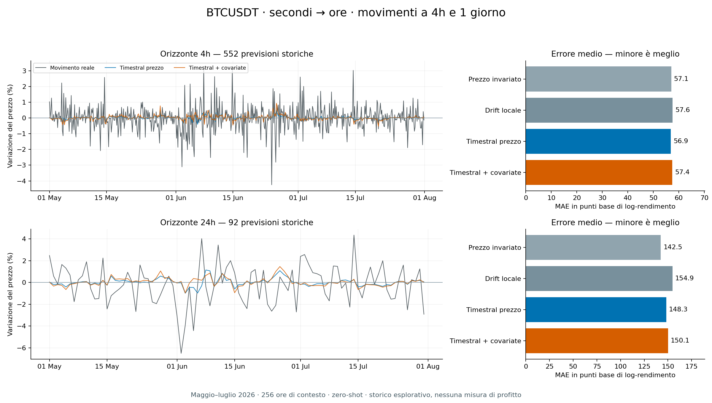

# BTCUSDT: previsioni storiche a 4 ore e 1 giorno

**Eseguiti 552 anchor a 4h e 92 a 24h**, per ciascuno dei quattro modelli, su maggio–luglio 2026. Nessun campione escluso. Timestral sul prezzo è quasi alla pari con il prezzo invariato a 4h e peggiore a 24h; le covariate derivate dai secondi non migliorano il risultato complessivo. Questa configurazione non dimostra un vantaggio operativo.

[Tutte le previsioni in CSV](forecasts.csv) · [Protocollo e comandi](../../docs/timestral-long-horizon.md) · [Audit indipendente](independent-verification.json)

## Cosa è stato eseguito

Fonte: [Binance Spot ufficiale](https://github.com/binance/binance-public-data), BTCUSDT, candele OHLCV al secondo dal 1 aprile al 1 agosto 2026 escluso. **10.540.800 secondi → 2.928 ore complete**. Il modello usa 256 ore precedenti (10 giorni e 16 ore), ricavate dai secondi, per prevedere il rendimento dopo 4 o 24 ore. I target non si sovrappongono entro ciascun orizzonte; i due orizzonti condividono osservazioni di mercato.

Aprile fornisce contesto e calibrazione. La valutazione copre 92 giorni, in tre blocchi mensili descrittivi senza tuning. I quattro confronti sono prezzo invariato, drift locale, Timestral sul log-prezzo e Timestral con volatilità intrahour calcolata dai 3.599 rendimenti al secondo, intensità degli scambi e imbalance taker. Sono state conservate tutte le 21 stime di quantile del modello.

Timestral-5M zero-shot, checkpoint e codice già fissati nel pilot, CPU e due thread. Nessun fine-tuning, nuovo modello scaricato o modifica ai protocolli precedenti. Il protocollo e gli hash sono stati registrati prima delle previsioni; ogni previsione è scritta prima di elaborare il suo target. I timestamp di calcolo sono quelli reali del 25 ottobre, non emissioni avvenute storicamente.

## Errori e direzione

MAE, RMSE e pinball sono in **punti base di log-rendimento**: valori più bassi sono migliori. La direzione è misurata sulle previsioni non neutrali; il prezzo invariato si astiene sempre. Gli altri modelli hanno emesso una direzione per tutti gli anchor.

| Orizzonte | Modello | MAE | RMSE | Pinball | Direzione corretta | Copertura 90% |
|---|---|---:|---:|---:|---:|---:|
| 4h | Prezzo invariato | 57.05 | 81.64 | 16.06 | neutrale | 89.67% |
| 4h | Drift locale | 57.56 | 82.34 | 16.22 | 49.82% | 90.04% |
| 4h | Timestral prezzo | 56.88 | 81.27 | 15.90 | 54.53% | 89.49% |
| 4h | Timestral + covariate | 57.44 | 81.87 | 16.08 | 53.08% | 89.13% |
| 24h | Prezzo invariato | 142.46 | 183.73 | 37.46 | neutrale | 88.04% |
| 24h | Drift locale | 154.93 | 194.27 | 39.91 | 53.26% | 90.22% |
| 24h | Timestral prezzo | 148.31 | 186.96 | 38.23 | 48.91% | 92.39% |
| 24h | Timestral + covariate | 150.08 | 190.00 | 38.48 | 48.91% | 89.13% |

A **4h**, Timestral prezzo riduce il MAE dello **0,31%** e l’RMSE dello 0,45% rispetto al prezzo invariato. Il MAE migliora in giugno e luglio, peggiora in maggio. La variante con covariate ha MAE peggiore dello 0,67% rispetto al prezzo invariato.

A **24h**, Timestral prezzo ha MAE peggiore del **4,11%** e RMSE peggiore dell’1,76%; il MAE è peggiore in tutti e tre i mesi. Con le covariate, il MAE peggiora del 5,35%. La precisione della direzione è 48,91% per entrambe le varianti Timestral. Gli errori assoluti tra 4h e 24h non sono direttamente confrontabili come misura di superiorità: i target hanno diversa variabilità.

Il bootstrap appaiato preregistrato usa 14 blocchi di sette giorni (l’ultimo breve), 2.000 estrazioni e seed 7. Differenza MAE **Timestral prezzo meno prezzo invariato**, in punti base:

| Orizzonte | Differenza media | Intervallo descrittivo 95% |
|---|---:|---:|
| 4h | -0.177 | [-0.810, +0.444] |
| 24h | +5.848 | [-1.584, +13.163] |

Entrambi gli intervalli includono zero. Sono descrittivi: pochi blocchi, possibile dipendenza tra settimane e confronti multipli limitano l’inferenza. Le coperture osservate non certificano probabilità calibrate di profitto; non ci sono quantili incrociati. I dati di training di Timestral non hanno un inventario completo verificabile: la contaminazione storica resta non escludibile.

## Esempi delle ultime previsioni

Le ultime tre previsioni cronologiche per ciascun orizzonte, variante **Timestral prezzo**, senza selezione per successo. Prezzi in USDT; la previsione è riferita all’ultimo close disponibile.

| Orizzonte | Anchor UTC | Prezzo iniziale | Prezzo previsto | Prezzo effettivo alla scadenza | Movimento previsto | Movimento reale |
|---|---|---:|---:|---:|---:|---:|
| 4h | 2026-07-31 12:00 | 63805.51 | 63812.32 | 62716.57 | +0.011% | -1.707% |
| 4h | 2026-07-31 16:00 | 62716.57 | 62726.92 | 62972.00 | +0.017% | +0.407% |
| 4h | 2026-07-31 20:00 | 62972.00 | 62994.17 | 62887.88 | +0.035% | -0.134% |
| 24h | 2026-07-29 00:00 | 63915.00 | 64004.92 | 63984.28 | +0.141% | +0.108% |
| 24h | 2026-07-30 00:00 | 63984.28 | 64100.89 | 64780.02 | +0.182% | +1.244% |
| 24h | 2026-07-31 00:00 | 64780.02 | 64813.51 | 62887.88 | +0.052% | -2.921% |

Il CSV contiene **2.576 righe**: 644 anchor × quattro modelli, con prezzi, variazioni percentuali, esiti, intervalli e conteggi di calibrazione. Tutti gli esiti sono maturi; non è una valutazione prospettica né una simulazione di profitto.

## Misure, verifiche e riproducibilità

- ZIP verificati: 282,3 MB; Parquet: 406,3 MB. I CSV sorgenti (1,54 GB) non sono stati estratti. Allocazione misurata di download e archivio: circa 771 MiB.
- Preparazione: 900,25 s; picco RSS 245 MiB. Preregistrazione con verifica integrale: 129,29 s.
- Backtest: 191,97 s di comando completo; 191,39 s nel blocco strumentato, inclusi 130,71 s per verificare nuovamente la fonte. **Picco RSS 4,36 GiB dell’intero processo**, comprendente lettore, Arrow e modello: il limite DuckDB non è un limite alla RAM totale. Non attribuire questo picco ai soli pesi.
- Inferenza mediana: circa 7 ms per la variante prezzo e 13 ms con covariate. Non include arrivo dati o esecuzione di un ordine.
- 96 test CI superati, inclusi 8 con TimescaleDB isolato; 88 test locali mirati superati, 8 integrazioni demandate alla CI. Dettagli in `ci.json`.
- Audit indipendente: lettura SQL diretta dei 122 Parquet, verifica di ogni prezzo/target, calibrazioni e metriche. Differenza massima nei log-rendimenti: zero. Nessun import del lettore sperimentale nel verificatore.
- Mac mini M4, 16 GiB RAM; SSD libero da 73,60 a 72,77 GiB. Riusati ambiente e checkpoint; tutti gli 11 file protetti controllati sono invariati. Nessuna operazione sul database di produzione.

I file di questa cartella sono copie delle evidenze effettive, controllate da `sha256.json`. Il protocollo conserva i percorsi originali; i dati e i pesi restano fuori Git. Il codice di esecuzione è nel commit `562f475`. Per ripetere usare una nuova directory come descritto nella [guida](../../docs/timestral-long-horizon.md). Il verificatore indipendente è incluso come `independent-verifier.py`; la sua destinazione di audit è esclusiva e non sostituisce un audit già salvato.

Il risultato ottenuto vale per questa configurazione e questo periodo. A 4h il miglioramento osservato è minimo; a 24h il riferimento più semplice resta migliore. Un’eventuale prova successiva deve conservare questo confronto e dichiarare nuovi dati e nuove scelte prima della valutazione.
