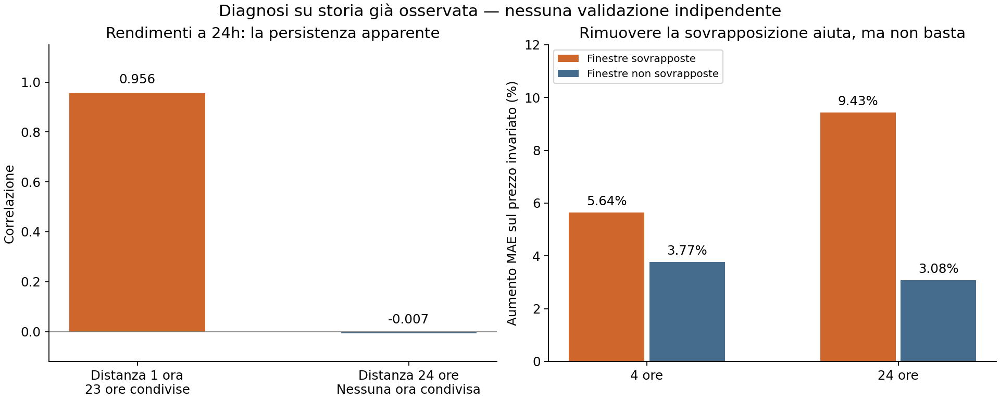

# Problema circoscritto: persistenza del passato, non segnale sul futuro

**Ho trovato un errore nell'attribuzione delle metriche e un limite concreto nella rappresentazione dei rendimenti che avevo proposto.** Ho corretto il primo e verificato il secondo con un confronto controllato. Rimuovere le finestre sovrapposte riduce l'errore, ma non produce un modello migliore del prezzo invariato.

[Codice e comandi](../../docs/timestral-diagnostics.md) · [Diagnostica completa](run/results.json) · [Confronto delle rappresentazioni](overlap/results.json) · [Verifica separata](verification.json)

## L'errore di misura che ho corretto

Nel report precedente il punto della baseline statica era zero, ma il suo quantile centrale era la mediana storica: +2,06 punti base a 4h e −7,01 a 24h. La baseline dinamica aveva anche la mediana a zero. Il pinball medio su tre quantili confrontava quindi **intervalli e mediane diversi**. Era scorretto descrivere tutto il miglioramento come effetto degli intervalli.

Il nuovo calcolo separa il punteggio degli estremi 5%/95% dalla mediana, e verifica anche il confronto a mediana identica. Copertura e larghezza precedentemente riportate non cambiano; nessuna previsione salvata è stata modificata.

| Periodo | Orizzonte | Riduzione del punteggio degli intervalli | Riduzione pinball totale a mediana identica |
|---|---|---:|---:|
| Gennaio–marzo | 4h | 6,09% | 2,46% |
| Gennaio–marzo | 24h | 9,11% | 3,86% |
| Gennaio–luglio | 4h | 5,22% | 2,14% |
| Gennaio–luglio | 24h | 3,95% | 1,58% |

Il punteggio degli intervalli penalizza sia l'ampiezza sia gli esiti fuori dai limiti. Il miglioramento rimane, ma riguarda l'incertezza e non la previsione del rendimento. La copertura mensile resta variabile, come già documentato.

## Cosa ho verificato prima di cambiare ancora il modello

- **Precisione numerica:** stessi 256 prezzi e stessi 1.484 anchor, centrati in float64 ed espressi in punti base prima della conversione float32. Lo scarto massimo della previsione è 0,0141 punti base a 4h e 0,0355 a 24h; nessuno supera la soglia dichiarata di 0,1. Il MAE resta sostanzialmente identico. In questi campioni la perdita di precisione non spiega il risultato negativo.
- **Controlli positivi:** con gli stessi pesi e lo stesso adattatore, le serie costanti sono previste esattamente. Su trend crescenti/decrescenti il MAE è inferiore al prezzo invariato del 92,70% a 4h e 99,04% a 24h; su quattro fasi sinusoidali del 91,81% e 99,30%. Il percorso di inferenza riconosce questi segnali noti. Ciò non garantisce capacità su ogni segnale di mercato.
- **Controllo negativo:** 128 cammini casuali indipendenti, con mediana condizionale teorica zero. Il modello è peggiore dello 0,80% a 4h e migliore dello 0,20% a 24h nel campione finito. Questo piccolo vantaggio casuale non viene trattato come capacità predittiva.

La forma degli input, l'indice finale e la normalizzazione sono stati confrontati con il [codice ufficiale fissato](https://github.com/mistralai/timestral/tree/a534bdbd244d64f3d9d743f46c7bf6fc330ed4ff). Non ho trovato evidenza di un endpoint sbagliato. I controlli non escludono qualsiasi altro possibile difetto.

## Il problema della rappresentazione che avevo proposto

Due rendimenti mobili a 24 ore calcolati a distanza di un'ora condividono **23 incrementi su 24**. La loro correlazione può essere alta anche se gli incrementi futuri sono indipendenti. Con incrementi indipendenti sarebbe 23/24 = 0,958; sulla storia disponibile è 0,956. A distanza di 24 ore, quando le finestre non si sovrappongono, scende a −0,007.

La precedente previsione Timestral sui rendimenti mobili a 24h è fortemente associata al rendimento passato (**0,947**) e negativamente a quello futuro (**−0,107**). Questi numeri indicano una forte dipendenza dal passato nella configurazione provata; da soli non dimostrano che la sovrapposizione sia l'unica causa.

Ho quindi registrato un solo confronto aggiuntivo prima di eseguirlo: rendimenti sovrapposti contro rendimenti non sovrapposti. Entrambi derivano dagli stessi **64 periodi di storia** e prevedono lo stesso rendimento futuro. Il primo avanza di h passi orari; il secondo di un passo lungo h ore. Cambiano cadenza e numero di valori forniti al modello, non i confini temporali della storia.

## Risultato del confronto controllato

1.272 anchor a 4h e 212 giornalieri, gennaio–luglio 2026. MAE in punti base; positivo nella colonna finale significa peggiore del prezzo invariato.

| Orizzonte | Rappresentazione | MAE | Errore rispetto al prezzo invariato |
|---|---|---:|---:|
| 4h | Prezzo invariato | 64,384 | 0,00% |
| 4h | Rendimenti sovrapposti | 68,013 | +5,64% |
| 4h | Rendimenti non sovrapposti | 66,810 | +3,77% |
| 24h | Prezzo invariato | 171,131 | 0,00% |
| 24h | Rendimenti sovrapposti | 187,261 | +9,43% |
| 24h | Rendimenti non sovrapposti | 176,394 | +3,08% |

L'associazione della previsione con il rendimento passato diminuisce da 0,551 a 0,459 a 4h e da 0,782 a 0,666 a 24h. Rimane comunque forte. **La variante non sovrapposta perde contro il prezzo invariato in tutti e sette i mesi, per entrambi gli orizzonti.** Non viene promossa.

Il bootstrap settimanale appaiato dà, per la differenza MAE non sovrapposto meno sovrapposto, un intervallo 98,75% di [−2,43; −0,014] punti base a 4h e [−25,22; +1,38] a 24h. A un giorno l'intervallo include zero: la riduzione osservata non è una dimostrazione robusta. Entrambi gli adattatori riconoscono anche i controlli deterministici; tutti i risultati sono conservati in [controls.json](overlap/controls.json).

Il nuovo confronto giornaliero usa **64 giorni**, mentre il precedente usava 256 ore. Parte della differenza rispetto al vecchio report può quindi dipendere dalla storia più lunga. Il confronto tra le due nuove varianti, sulla stessa storia, è quello pertinente. Anche questo cambia insieme sovrapposizione, cadenza e numero di valori: non identifica un'unica causa universale.

## Verifiche e limiti

I due protocolli sono stati registrati in sequenza: il secondo nasce dai risultati del primo. Sono conservati input hash, codice, previsioni, esiti e controlli. **Storia già osservata, non nuovo holdout.** Nessun dato del periodo protetto agosto 2026–febbraio 2027 è stato aperto; nessun download o nuovo ambiente. Nessuna selezione retroattiva né servizio attivato.

Sono stati aggiunti 14 test. La suite locale supera **173 test**, con otto integrazioni riservate alla CI. Il [verificatore separato](verify.py) ricostruisce target e finestre, confronti degli intervalli, MAE/RMSE e quattro bootstrap dai file salvati senza importare le due pipeline. Non riesegue il modello e non crea evidenza prospettica.

Risorse misurate, senza preparazione degli archivi: controlli iniziali 16,60 s / 276,13 MiB RSS; confronto delle rappresentazioni 30,25 s / 303,91 MiB RSS. Pesi e cache esistenti riusati.

**Conclusione circoscritta:** ho corretto la misura dell'incertezza e trovato una rappresentazione che enfatizzava la persistenza passata. Eliminarne la sovrapposizione aiuta, ma il segnale utile sul rendimento futuro resta non dimostrato. Questi risultati non provano che BTC sia imprevedibile né che ogni modello Timestral fallisca; impediscono di attribuire il fallimento osservato soltanto alla precisione numerica o di dichiarare risolta la previsione con questa trasformazione.
